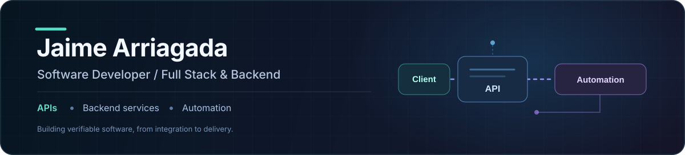

  

  <strong>Software Developer | Full Stack &amp; Backend | Systems Integration</strong>

I develop **web applications, REST APIs, backend services, and system integrations**. My focus is turning concrete requirements into maintainable software: from interfaces and database changes to authentication, deployment tooling, and automated tests.

## Featured project — Canvas LMS Feedback Plugin

### [Canvas LMS + LTI 1.3 | Full Stack integration](https://github.com/JaimeArriagadaRosas/Plugin-Feedback-Canvas)

**Completed project · Runs locally · Developed by me · Solution requested by UNIDA (Universidad Andrés Bello)**

I built a Full Stack feedback solution that connects with **Canvas LMS through LTI 1.3**. It uses a React interface, Node.js/Express REST services, and PostgreSQL to support academic feedback workflows, including AI-assisted generation and instructor review before delivery.

**What I built and solved:**

- **Full Stack features:** Implemented and integrated administration-panel improvements, REST endpoints, and PostgreSQL migrations for system configuration and AI-provider settings.
- **LMS integration and authentication:** Fixed Canvas integration issues involving OAuth2, token handling, file previews, controllers, middleware, and backend services.
- **Deployment tooling:** Automated installation and maintenance tasks using Docker and HTTPS/TLS, addressing filesystem permissions, non-privileged execution, and compatibility across Windows and Linux environments.
- **Software quality:** Added regression tests and diagnostic tools to reproduce integration issues, verify fixes, and make local setup more consistent.
- **Feedback workflow:** Connected the application to a process where generated academic feedback can be reviewed and approved by the instructor before submission.

**Stack:** React · JavaScript · Node.js · Express · REST APIs · PostgreSQL · Redis · Docker · LTI 1.3 · OAuth2 · HTTPS/TLS

**Evidence:** [Source code](https://github.com/JaimeArriagadaRosas/Plugin-Feedback-Canvas) · [System architecture](https://github.com/JaimeArriagadaRosas/Plugin-Feedback-Canvas/blob/main/docs/ARCHITECTURE.md) · [Testing strategy](https://github.com/JaimeArriagadaRosas/Plugin-Feedback-Canvas/blob/main/docs/TESTING.md)

> **Scope:** The solution is finished for its local execution environment. This is not a claim of an institution-wide production deployment.

## What I can build

- **Web applications:** Interfaces connected to APIs and business workflows.
- **Backend services and integrations:** REST endpoints, authentication, database-backed features, and connections between systems.
- **Automation and tooling:** Repeatable processing workflows, development environments, installation tooling, and diagnostics.
- **Testing and maintainability:** Regression coverage, modular implementation, troubleshooting, and reproducible setup.

## Other selected projects

### [Transcribe — local multimedia automation](https://github.com/JaimeArriagadaRosas/Transcribe)
Python application that processes authorized Zoom recordings and YouTube content, tracks interrupted transcription jobs, and exports TXT, SRT, and VTT using faster-whisper.

### [Colegio Horizonte — web engineering demo](https://github.com/JaimeArriagadaRosas/colegio-horizonte)
React and TypeScript institutional website **demonstration for a fictional school**, focused on responsive design, accessibility, SEO, security headers, CI, and automated checks.

## Technical toolkit

- **Languages:** JavaScript, TypeScript, Python, SQL
- **Full Stack and backend:** React, Node.js, Express, FastAPI, REST APIs
- **Data and infrastructure:** PostgreSQL, Redis, Docker, Git/GitHub
- **Engineering:** Systems integration, modular architecture, automated testing, GitHub Actions

**Additional repositories:** [Clinical Intelligence Platform](https://github.com/JaimeArriagadaRosas/clinical-drg-predictor) · [LithiumScope](https://github.com/JaimeArriagadaRosas/LithiumScope)

## GitHub activity

  <picture>
    <source media="(prefers-color-scheme: dark)" srcset="https://raw.githubusercontent.com/JaimeArriagadaRosas/JaimeArriagadaRosas/output/contributions-badge-dark.svg" />
    <source media="(prefers-color-scheme: light)" srcset="https://raw.githubusercontent.com/JaimeArriagadaRosas/JaimeArriagadaRosas/output/contributions-badge.svg" />
    
  </picture>

  <picture>
    <source media="(prefers-color-scheme: dark)" srcset="https://raw.githubusercontent.com/JaimeArriagadaRosas/JaimeArriagadaRosas/output/github-snake-dark.svg" />
    <source media="(prefers-color-scheme: light)" srcset="https://raw.githubusercontent.com/JaimeArriagadaRosas/JaimeArriagadaRosas/output/github-snake.svg" />
    
  </picture>

## Connect

[LinkedIn](https://www.linkedin.com/in/jaime-arriagada-rosas-528bb5204/) · [GitHub](https://github.com/JaimeArriagadaRosas)
